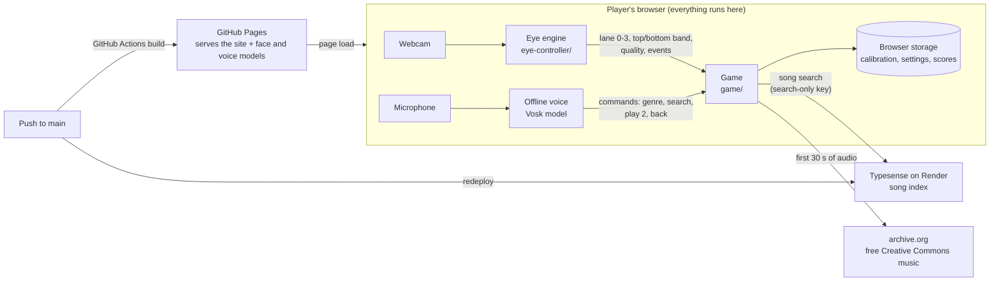

# RhythmEyez

**A rhythm game you play with your eyes, using only a normal webcam.**
No eye-tracking hardware, no controller, no hands. Built at EmoryHacks 2026.

▶ **Play it:** https://harrison07072003.github.io/EmoryHacks2026-GGC/ (Chrome, allow the camera)

## What it does

- **4 lanes × 2 bands:** look at a lane to hit notes in the top band; follow the moving path
  in the bottom band with your eyes.
- **Webcam eye tracking in the browser:** your face and eyes are tracked on your own computer.
  No video is uploaded or stored.
- **Hands-free menus:** look at a button for 2 seconds to press it. Pages that don't fit the window
  get ▲ / ▼ buttons you look at to scroll.
- **Calibration that checks itself:** face check, gaze-checked dots, a moving dot and top/bottom
  hops, then a score. If your head moves too much mid-song, a quick recalibration kicks in.
- **Online Library:** search free archive.org music by voice or with an on-screen keyboard you
  type on with your eyes, and the game builds a level from the song. Voice runs offline in the
  browser (no Google service needed).

## How everything connects



**In words:**

1. **GitHub Pages hosts the website.** Every push to `main` runs a GitHub Actions workflow
   ([`.github/workflows/pages.yml`](.github/workflows/pages.yml)). It installs both packages,
   downloads the face model and the voice model, builds the game and publishes it.
2. **The eye engine and the game run in the player's browser.** The engine reads the webcam and
   gives the game simple signals: which lane, which band, how reliable the tracking is, and events
   such as "face lost". The game only uses that public interface
   ([`eye-controller/README.md`](eye-controller/README.md)), so the engine could power other games.
3. **Voice runs in the browser too.** The Vosk speech model (41 MB, loaded once) turns speech into
   text, and the game turns that text into commands. No speech service is needed.
4. **Song search is the only server.** Typesense runs on Render
   ([`game/server/typesense/`](game/server/typesense/README.md)) and holds the list of songs. The
   website gets a search-only key, so it can search and do nothing else.
5. **Songs come from archive.org.** The game fetches the first 30 seconds of a track, finds the
   beat and builds the level in the browser. There's an optional level server (`game/server`) that
   caches levels, but the game works without it.
6. **Nothing personal leaves the browser.** Webcam video and microphone audio are processed
   locally. Calibrations, settings and scores are saved in the browser's own storage.

**What still works if a piece is down:**

| If this is down | Still works | Stops |
|---|---|---|
| Render (search) | built-in songs, eye tracking, calibration | Online Library search |
| archive.org | built-in songs | playing Online Library songs |
| Internet entirely (after the page has loaded) | built-in songs, eye tracking, voice | Online Library |

## How the eye tracking works

1. **Face landmarks:** MediaPipe Face Landmarker finds 478 points on your face, including the irises.
2. **Eye measurements:** our pupil finder turns each frame into 19 numbers (pupil position in each
   eye, head position and turn).
3. **Personal calibration:** ridge regression learns how your numbers map to the screen.
4. **Smoothing:** a One Euro filter plus fixation / saccade detection keeps gaze steady but fast.
5. **Game input:** gaze becomes lane 0-3 and top/bottom band, with a sticky margin so it doesn't flicker.

Measured on recorded sessions: **95% / 94%** of lane jumps / band switches on target without
glasses, **91% / 84%** with glasses; about 115 ms gaze delay.

## Run it locally

Needs Node 20+ and Chrome.

```bash
npm --prefix eye-controller install
npm --prefix eye-controller run fetch-model
npm --prefix game install
npm --prefix game run fetch-voice-model
npm --prefix game run dev
```

Open **http://localhost:5190** and allow the camera. Add `?input=mouse` to the URL to try it with
the mouse instead of your eyes.

All commands: [COMMANDS.md](COMMANDS.md).

## Project layout

| Folder | What's in it |
|---|---|
| [`eye-controller/`](eye-controller/README.md) | the eye-tracking engine (webcam → gaze, lane, band), its debug and recording pages, tests |
| [`game/`](game/README.md) | the RhythmEyez game, the Online Library (search, voice, eye keyboard), and its servers |
| `app/` | earlier prototype minigames |
| `.github/workflows/` | builds the game and publishes it to GitHub Pages on every push to `main` |

## Built with

JavaScript, Vite, MediaPipe Tasks Vision (face landmarks), Web Audio, Vosk (offline speech
recognition), Typesense (song search, hosted on Render), archive.org (Creative Commons music),
Vitest, GitHub Pages.
